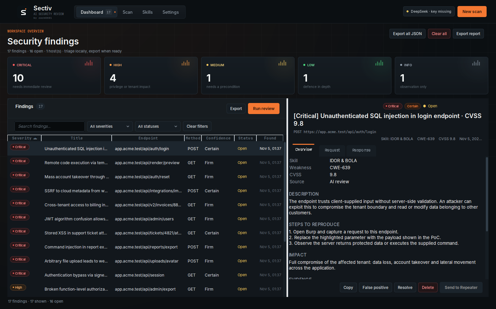

# Sectiv

**Skill-driven AI security review for Burp Suite.**

Sectiv turns captured Burp traffic into a triaged vulnerability dashboard. You choose a scope from Burp's proxy history or site map, pick a review goal ("skill"), add optional authorization context for two accounts, and let a model of your choice review the traffic. Findings land in a dashboard grouped by severity, with evidence, remediation, raw request/response data and report export.

The extension is built with Kotlin, the Montoya API and Swing. It has no Python runtime and no external service other than the AI provider you configure.



## Features

- **Severity dashboard** — Critical, High, Medium, Low and Info counters, filterable tables, search, status triage (Open / Triaged / False positive / Resolved) and HTML / Markdown / JSON export.
- **Scope picker** — load proxy history or site map, filter by host/path/method, restrict to Burp scope, collapse duplicate endpoints, and tick the requests to review.
- **Skills** — built-in review goals for BOLA/IDOR, function-level authorization, authentication/session issues, SQLi, XSS, SSRF, sensitive data exposure, business logic, mass assignment and file handling. Create, edit, duplicate, import and export your own Markdown skills.
- **Goal-based scanning** — run one skill or a full sweep of all enabled skills. Traffic is packed into token-budgeted chunks, with progress, cancellation and a live run log.
- **Identity context** — paste emails, cookies and authorization headers for User A and User B. The model uses this for BAC/IDOR reasoning, and Sectiv can optionally perform a deterministic **identity-swap check**: replay selected requests with User B's credentials and compare responses with User A's.
- **Multiple providers** — DeepSeek, Claude (Anthropic), OpenAI, GLM (Zhipu), z.ai, OpenRouter, local Ollama and any custom OpenAI-compatible endpoint.
- **Privacy controls** — cookie values, authorization headers, passwords, API keys and JWTs are masked before traffic is sent to the model. Email addresses are deliberately kept because they are a primary BOLA/IDOR signal. Masking can be disabled in Settings.
- **Safe defaults** — active identity-swap checks are off by default, require explicit confirmation, only use GET/HEAD/OPTIONS unless enabled otherwise, and are rate-limited.

## Build

Requirements: JDK 21 and network access for the first Gradle run.

```bash
./gradlew test          # unit + headless UI tests
./gradlew shadowJar     # build the loadable extension
```

The extension JAR is written to:

```
build/libs/sectiv-1.0.0.jar
```

The JAR bundles the Kotlin runtime and a relocated copy of Jackson. The Montoya API is compiled against but not bundled; Burp provides it at runtime.

## Install

1. Open Burp Suite → **Extensions → Installed**.
2. Click **Add**, choose extension type **Java**.
3. Select `build/libs/sectiv-1.0.0.jar`.
4. A **Sectiv** suite tab appears.

The code is compiled against Montoya API `2026.7` and Java 21. Use a current Burp release; older releases may reject the extension.

## Use

1. **Settings → AI provider** — choose a provider, set the base URL/model, paste an API key, and use **Test connection**. Save.
2. **Scan → Target scope** — load proxy history or the site map, filter and tick the requests to review. **In scope** selects only items inside Burp's target scope.
3. **Scan → Review goal** — choose one skill, or enable **Run all enabled skills**.
4. **Scan → Identity context** — optionally paste two accounts. The template inserts a parseable layout:
   ```
   User A
     email: alice@example.com
     Cookie: session=...
     Authorization: Bearer ...

   User B
     email: bob@example.com
     Cookie: session=...
     Authorization: Bearer ...
   ```
   One-line notes such as `User A cookie is: session=...` are also parsed.
5. Click **Run scan**. Findings appear immediately in the dashboard as chunks complete.
6. Optionally enable **Verify with identity swap**. Sectiv replays the selected success responses with User B's credentials and flags responses that still return User A's data. You are asked to confirm the request count first.
7. Triage in **Dashboard**, then export an HTML, Markdown or JSON report.

## How the AI review works

The model does not issue requests by itself. Sectiv builds a prompt from:

- the selected skill's review instructions,
- the tester's identity context,
- redacted captured HTTP request/response pairs, packed into chunks that fit the configured character budget.

The system prompt requires a single JSON object, forbids inventing endpoints and treats captured traffic as untrusted data (prompt-injection defence). Sectiv parses the response defensively, deduplicates findings by fingerprint, and retries once with a stricter prompt if the model returns malformed JSON.

The identity-swap check is separate and deterministic: Sectiv replaces the matching session cookie or authorization header with User B's value, sends the request through Burp, and compares status, length and response similarity. Findings are marked `active check` in the dashboard and include the exact request that was sent.

## Data and privacy

- State is stored at `~/.sectiv/state.json` and written atomically with `0600` permissions where the filesystem supports them.
- The file contains settings, API keys, skills, the last identity context and all findings (including capped raw request/response excerpts). **It is not encrypted.** Use a dedicated API key and rotate it if the host is shared.
- The state file is global to the Burp installation, not per project. Use export before switching engagements, and clear findings when appropriate.
- Captured traffic is sent to the configured AI provider. Confirm that this is allowed for your engagement before scanning. Use **Settings → Scan behavior → Mask cookies and tokens** (on by default) and review the selected scope.
- Identity-swap checks send real traffic with the second account's credentials. Only run them against systems you are authorized to test.

## Project layout

```
src/main/kotlin/io/sectiv/burp/
  SectivExtension.kt        Burp entry point
  core/                     models, state, identity parsing, redaction, transcript
  ai/                       prompt building, finding parser, provider HTTP client
  scan/                     history collection, scan orchestration, identity swap
  ui/                       custom Swing dashboard, scan, skills and settings tabs
  report/                   HTML, Markdown and JSON reports
src/test/kotlin/            unit, scan-pipeline and headless UI tests
```

## Links

[](https://sectiv.ai)
[](https://www.youtube.com/@zack0x01)
[](https://x.com/zack0x01_)
[](https://www.instagram.com/zacl0x01/)
[](https://www.buymeacoffee.com/zack0x01)

## Limitations

- This is an **AI-assisted review**, not a replacement for Burp Scanner or manual testing. Validate every finding before reporting it.
- The AI only reasons about the traffic you select; it cannot discover endpoints that are absent from that traffic.
- Active identity-swap checking is a heuristic. A high-similarity response can still be a public or shared resource; the finding text tells you to confirm ownership.
- Model names and endpoints change. If **Test connection** fails, update the model identifier in Settings.
- AI calls can be slow or expensive. Use a focused scope and one skill at a time for large engagements.

## Development notes

- `./gradlew test` runs 40+ tests including redaction, identity parsing, prompt chunking, report escaping, persistence, the full scan pipeline with a fake model, and a headless Swing smoke test.
- The UI uses no third-party look-and-feel. Colors adapt to Burp's dark/light theme via `UserInterface.currentTheme()`.
- To add a provider preset, edit `defaultProviders()` in `core/Models.kt`. To add a built-in skill, edit `core/DefaultSkills.kt`.
